<!-- markdownlint-disable blank_lines html emphasis blanks-around-tables-->

# Slime Molds and Cognitive Maps

<!-- _header: ""-->

*November 24st, 2026*

*Oğul Can Yurdakul*

*Department of Cognitive Science, UC Irvine*

|Click the links!|Presentation|Handout|
|-|:-:|:-:|
|Dark mode|[link](https://ogulyurdakul.github.io/files/cogs229_slimeMold/)|[link](https://ogulyurdakul.github.io/files/cogs229_slimeMold/dark_hanout.pdf)|
|Light mode|[link](https://ogulyurdakul.github.io/files/cogs229_slimeMold/light.html)|[link](https://ogulyurdakul.github.io/files/cogs229_slimeMold/light_hanout.pdf)|

---
<!-- markdownlint-disable blank_lines html emphasis blanks-around-tables-->

# Slime Molds and Cognitive Maps

<!-- _header: ""-->

*November 24st, 2026*

*Oğul Can Yurdakul*

*Department of Cognitive Science, UC Irvine*

|Click the links!|Presentation|Handout|
|-|:-:|:-:|
|Dark mode|[link](https://ogulyurdakul.github.io/files/cogs229_slimeMold/)|[link](https://ogulyurdakul.github.io/files/cogs229_slimeMold/dark_hanout.pdf)|
|Light mode|[link](https://ogulyurdakul.github.io/files/cogs229_slimeMold/light.html)|[link](https://ogulyurdakul.github.io/files/cogs229_slimeMold/light_hanout.pdf)|

- [World of the Slime Mold](#world-of-the-slime-mold)
  - [The slime itself: *Physarum polycephalum*](#the-slime-itself-physarum-polycephalum)
  - [Mapping the world with/of the slime mold](#mapping-the-world-withof-the-slime-mold)
  - [To err is ~~human~~ slime mold](#to-err-is-human-slime-mold)
- [Computational Models](#computational-models)
  - [Analyticaly derived models](#analyticaly-derived-models)
  - [Monte Carlo-based models](#monte-carlo-based-models)
  - [Shortcomings of the current models](#shortcomings-of-the-current-models)
- [Results and Outcomes](#results-and-outcomes)
- [Future directions](#future-directions)

---

<!-- 
footer: "
    Adamatzky (ed.) (2016) “Advances in Physarum Machines,” https://doi.org/10.1007/978-3-319-26662-6

    Mayne (2016). “Biology of the Physarum polycephalum Plasmodium: Preliminaries for Unconventional Computing,” In: Adamatzky, A. (eds) Advances in Physarum Machines. https://doi.org/10.1007/978-3-319-26662-6_1

    Li et al. (2020) “Slime mould algorithm: A new method for stochastic optimization,” https://www.sciencedirect.com/science/article/pii/
"
-->

## World of the Slime Mold

### The slime itself: *Physarum polycephalum*

- eukaryote but not a fungus!
  - amoeboid protist
- "syncytium:" one cell, *millions* of nuclei!

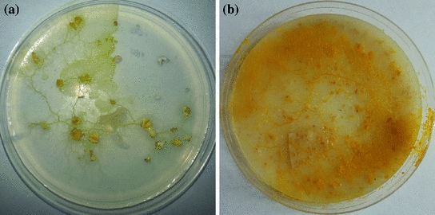
- plasmodium: mobile form
  - few mm$^2$ to over half a m$^2$
  - can move up to 1cm/h
- has inspired many work, including an optimization algorithm

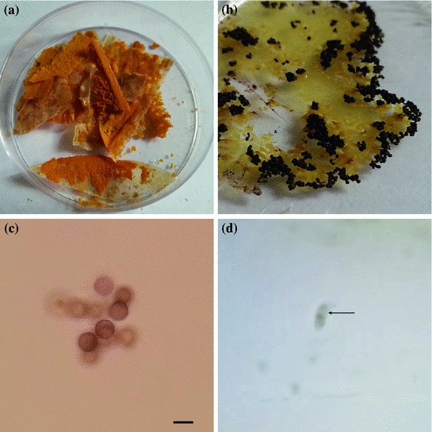
(a) Fragments of sclerotium. (b) Sporangia. (c) Spores. (d) Swarm cell (arrowed). c, d Scale bar = 10$\upmu$m

---

### Mapping the world with/of the slime mold

#### Slime molds as path finders

<!-- 
footer: "
    Nakagaki et al. (2000) “Maze-solving by an amoeboid organism,” https://www.nature.com/articles/35035159

    Tero et al. (2010), “Rules for Biologically Inspired Adaptive Network Design,”  https://www.science.org/doi/10.1126/science.1177894
"
-->

- Maze solving
  <!-- 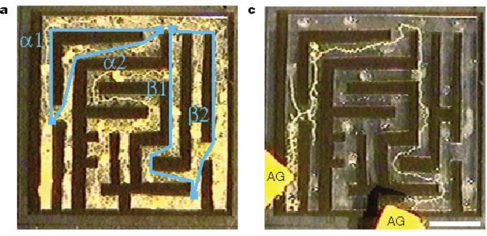  -->
$\quad\quad$<video src="mazeSolvingReal.mp4" controls height="400" allowfullscreen></video>

[Youtube: Slime mold solving a maze in the lab](https://www.youtube.com/watch?v=F3z_mdaQ5ac)

---

### Mapping the world with/of the slime mold

#### Slime molds as path finders

<!-- 
footer: "
    Nakagaki et al. (2000) “Maze-solving by an amoeboid organism,” https://www.nature.com/articles/35035159

    Tero et al. (2010), “Rules for Biologically Inspired Adaptive Network Design,”  https://www.science.org/doi/10.1126/science.1177894
"
-->

- Maze solving
  <!--   -->
$\quad\quad$<video src="mazeSolvingReal.mp4" controls height="400" allowfullscreen></video>

[Youtube: Slime mold solving a maze in the lab](https://www.youtube.com/watch?v=F3z_mdaQ5ac)

- Tokyo subway map
    <!-- 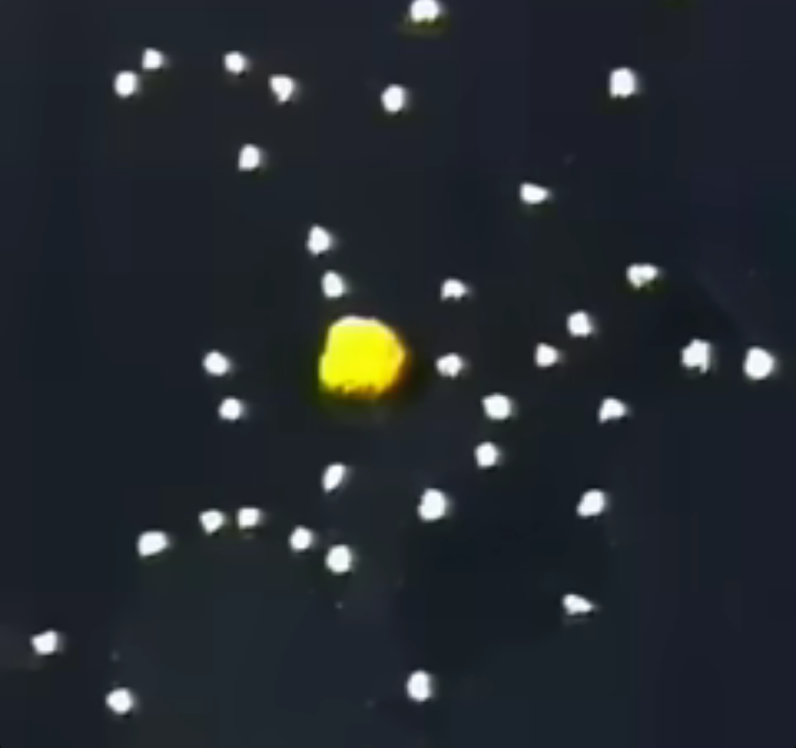 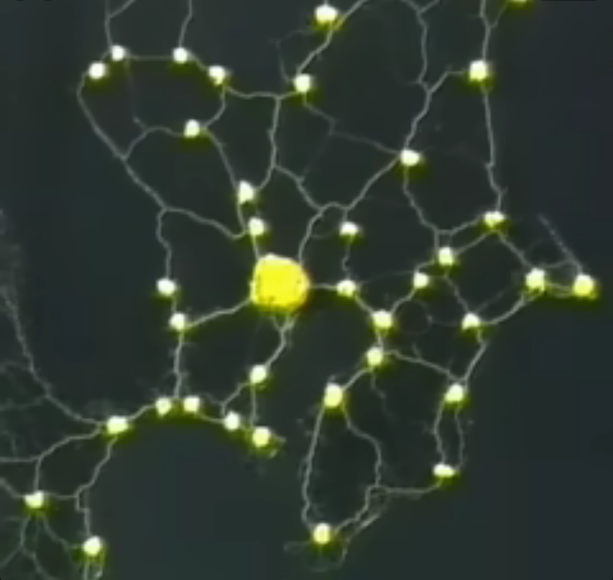  -->
$\quad\quad\quad\quad$<video src="tokyoMap.mp4" controls height="400" allowfullscreen></video>

[Youtube: Slime mold form a map of the Tokyo-area railway system](https://www.youtube.com/shorts/GwKuFREOgmo)

---

### Mapping the world with/of the slime mold - 2

#### Slime molds as "problem solvers"

<!-- 
footer: "
    
    Bajpai et al. (2026) “Tracking and distinguishing slime mold solutions to traveling salesperson problems through synchronized amplification in the non-equilibrium steady state,” http://arxiv.org/abs/2504.03492

    Reid and Beekman (2013) “Solving the Towers of Hanoi – how an amoeboid organism efficiently constructs transport networks,” https://doi.org/10.1242/jeb.081158
"
-->

- Traveling salesperson problem
  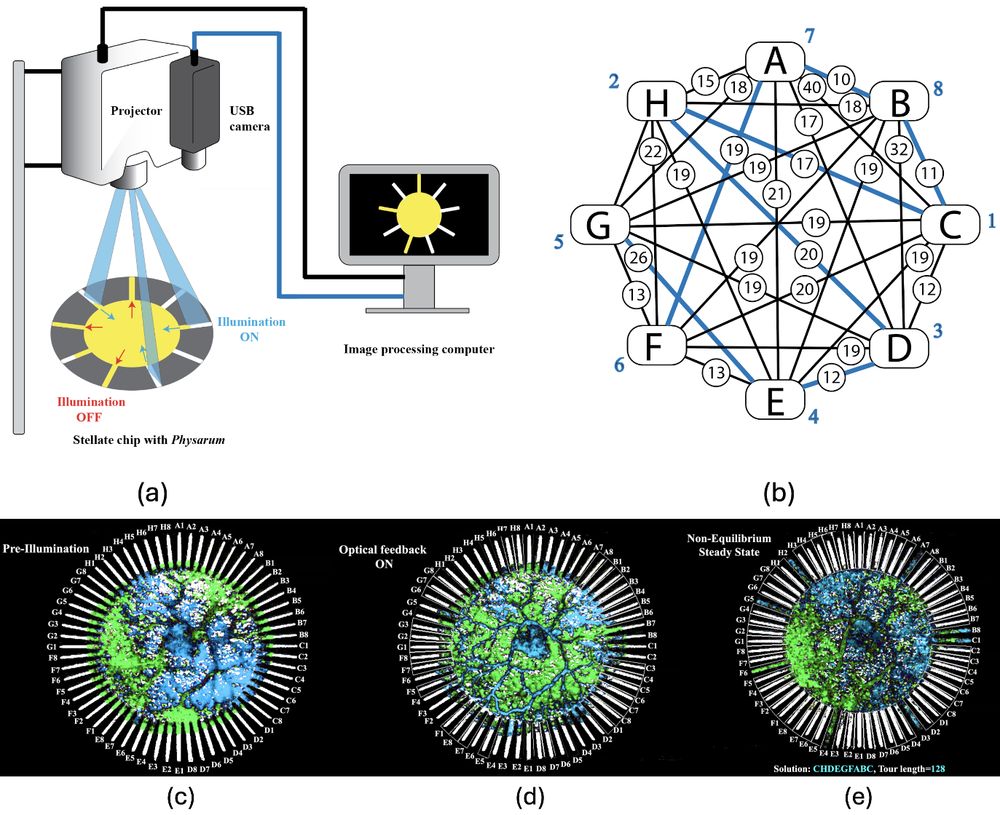

---

### Mapping the world with/of the slime mold - 2

#### Slime molds as "problem solvers"

<!-- 
footer: "
    
    Bajpai et al. (2026) “Tracking and distinguishing slime mold solutions to traveling salesperson problems through synchronized amplification in the non-equilibrium steady state,” http://arxiv.org/abs/2504.03492

    Reid and Beekman (2013) “Solving the Towers of Hanoi – how an amoeboid organism efficiently constructs transport networks,” https://doi.org/10.1242/jeb.081158
"
-->

- Traveling salesperson problem
  

- Towers of Hanoi puzzle
   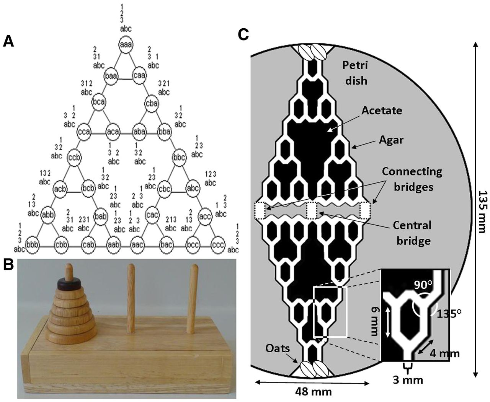 
   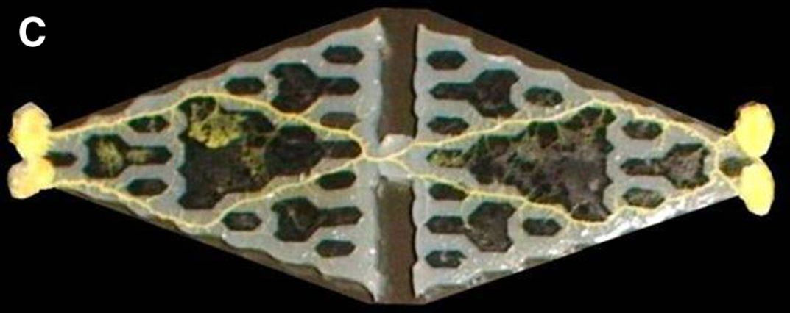

---

### Mapping the world with/of the slime mold - 3

#### Slime molds as ???

<!-- 
footer: "
    Kay et al., (2022) “Stepwise slime mould growth as a template for urban design,” https://www.nature.com/articles/s41598-022-05439-w

    Evangelidis et al., (2017) “Physarum machines imitating a Roman road network: the 3D approach,” https://www.nature.com/articles/s41598-017-06961-y

    Adamatzky, (2012) “The World’s Colonisation and Trade Routes Formation as Imitated by Slime Mould,” https://arxiv.org/abs/1209.3958v1

"
-->

- Urban designers?
  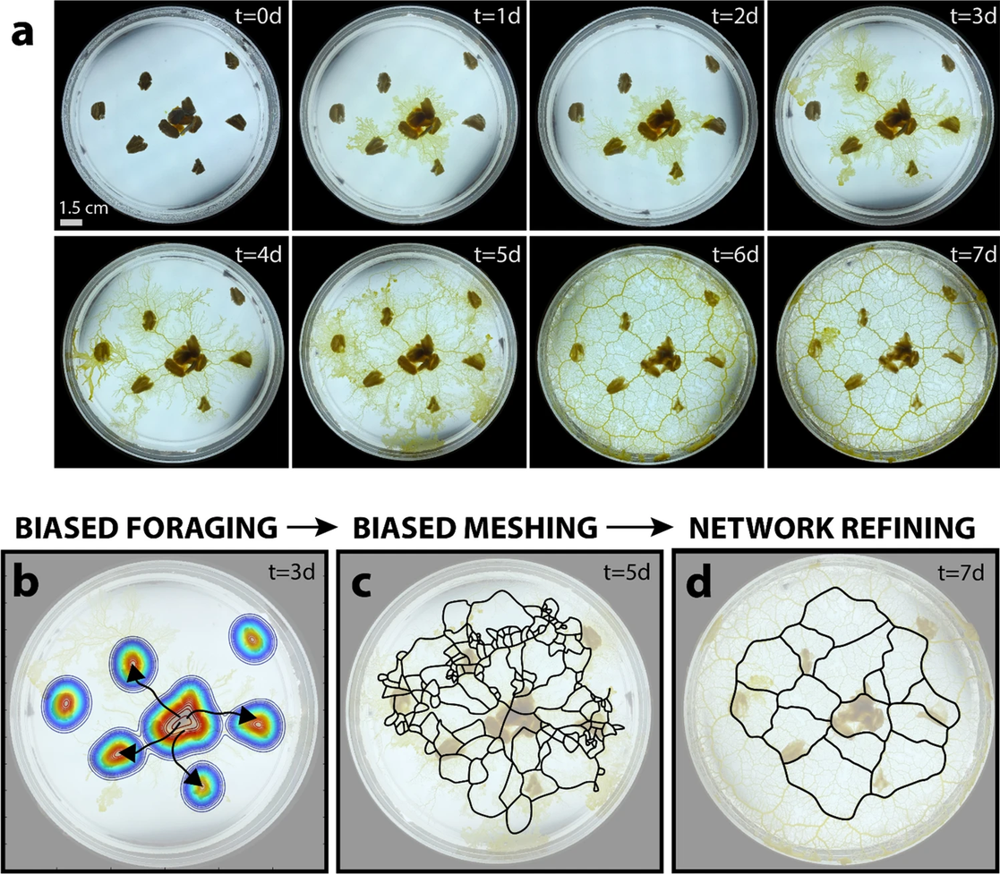

---

### Mapping the world with/of the slime mold - 3

#### Slime molds as ???

<!-- 
footer: "
    Kay et al., (2022) “Stepwise slime mould growth as a template for urban design,” https://www.nature.com/articles/s41598-022-05439-w

    Evangelidis et al., (2017) “Physarum machines imitating a Roman road network: the 3D approach,” https://www.nature.com/articles/s41598-017-06961-y

    Adamatzky, (2012) “The World’s Colonisation and Trade Routes Formation as Imitated by Slime Mould,” https://arxiv.org/abs/1209.3958v1

"
-->

- Urban designers?
  

- Romans??
  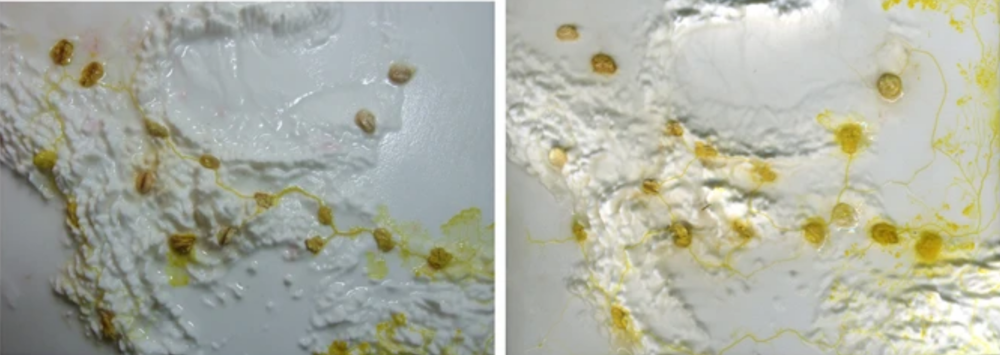

---

### Mapping the world with/of the slime mold - 3

#### Slime molds as ???

<!-- 
footer: "
    Kay et al., (2022) “Stepwise slime mould growth as a template for urban design,” https://www.nature.com/articles/s41598-022-05439-w

    Evangelidis et al., (2017) “Physarum machines imitating a Roman road network: the 3D approach,” https://www.nature.com/articles/s41598-017-06961-y

    Adamatzky, (2012) “The World’s Colonisation and Trade Routes Formation as Imitated by Slime Mould,” https://arxiv.org/abs/1209.3958v1

"
-->

- Urban designers?
  

- Romans??
  

- Colonizers???
  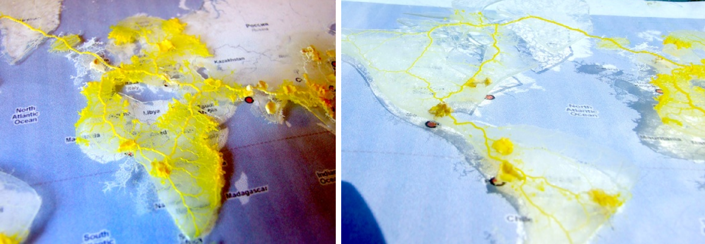
  <!--  -->

---

### To err is ~~human~~ slime mold

<!-- 
footer: "
    Latty and Beekman (2011) “Speed-accuracy trade-offs during foraging decisions in the acellular slime mould Physarum polycephalum,” https://dx.doi.org/10.1098/rspb.2010.1624

    ——, (2011) “Irrational decision-making in an amoeboid organism: transitivity and context-dependent preferences,” https://pmc.ncbi.nlm.nih.gov/articles/PMC3013386/
"
-->

#### Speed-accuracy trade-off

when having to choose between food sources, adding stressors reduce accuracy of choosing the larger one

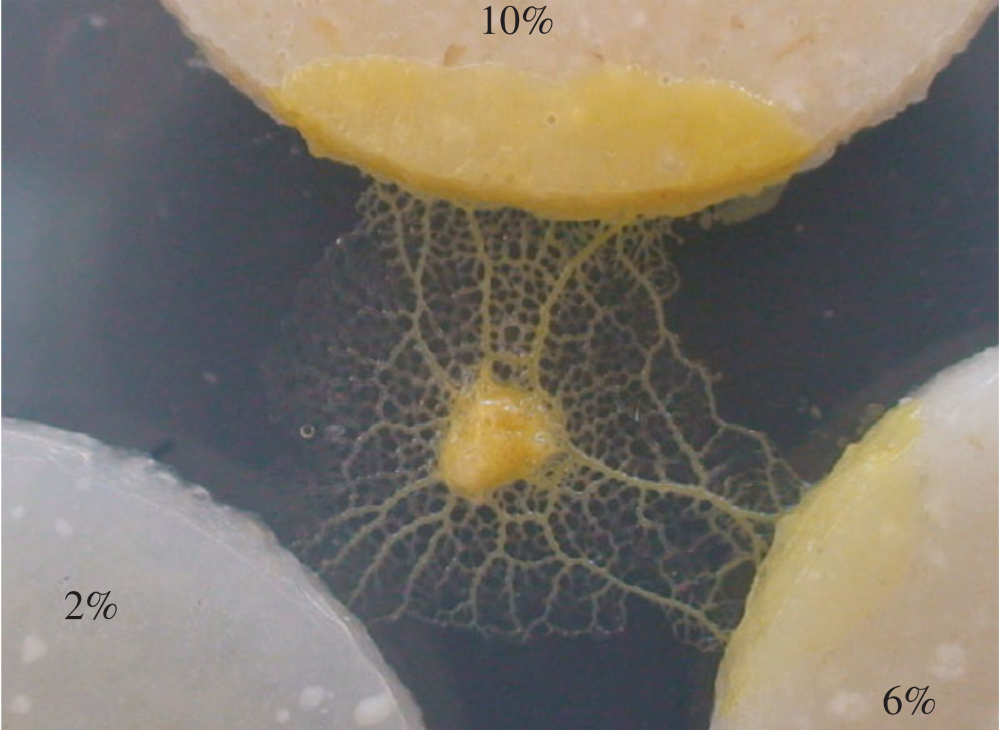

---

### To err is ~~human~~ slime mold

<!-- 
footer: "
    Latty and Beekman (2011) “Speed-accuracy trade-offs during foraging decisions in the acellular slime mould Physarum polycephalum,” https://dx.doi.org/10.1098/rspb.2010.1624

    ——, (2011) “Irrational decision-making in an amoeboid organism: transitivity and context-dependent preferences,” https://pmc.ncbi.nlm.nih.gov/articles/PMC3013386/
"
-->

#### Speed-accuracy trade-off

when having to choose between food sources, adding stressors reduce accuracy of choosing the larger one

dark: easy
gray: difficult

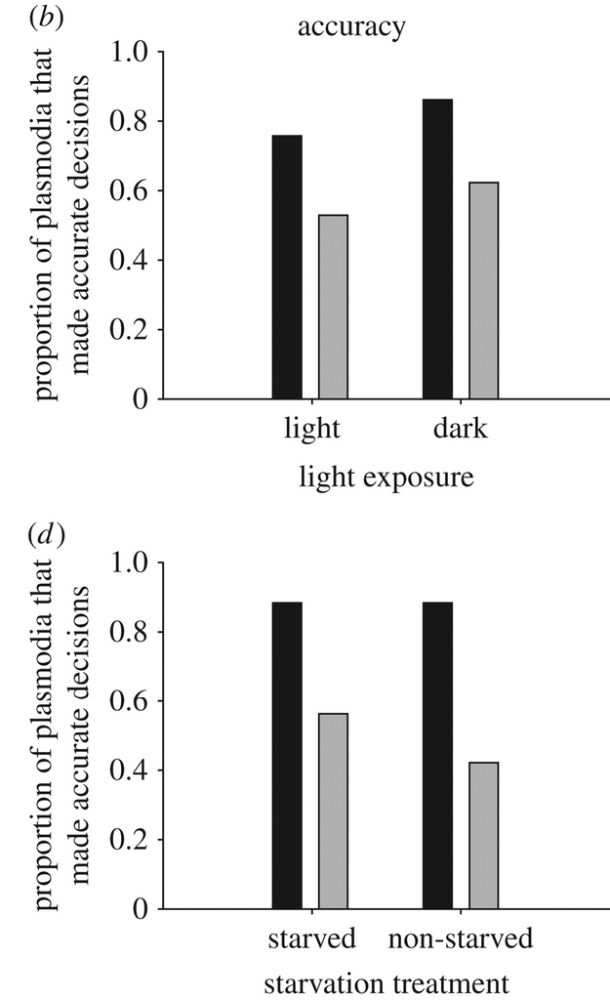

---

### To err is ~~human~~ slime mold

<!-- 
footer: "
    Latty and Beekman (2011) “Speed-accuracy trade-offs during foraging decisions in the acellular slime mould Physarum polycephalum,” https://dx.doi.org/10.1098/rspb.2010.1624

    ——, (2011) “Irrational decision-making in an amoeboid organism: transitivity and context-dependent preferences,” https://pmc.ncbi.nlm.nih.gov/articles/PMC3013386/
"
-->

#### Speed-accuracy trade-off

when having to choose between food sources, adding stressors reduce accuracy of choosing the larger one

dark: easy
gray: difficult

#### Independence of Irrelevant Alternatives

when an overall worse option is introduced into a choice among two, slime molds sometimes choose it

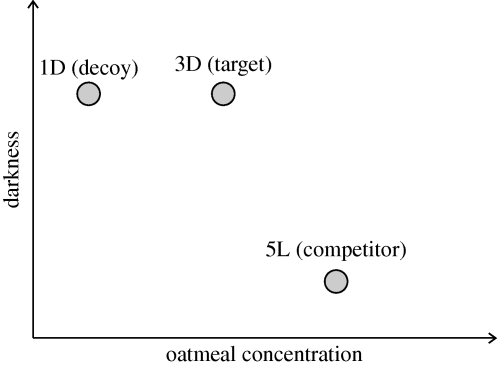

---

### To err is ~~human~~ slime mold

<!-- 
footer: "
    Latty and Beekman (2011) “Speed-accuracy trade-offs during foraging decisions in the acellular slime mould Physarum polycephalum,” https://dx.doi.org/10.1098/rspb.2010.1624

    ——, (2011) “Irrational decision-making in an amoeboid organism: transitivity and context-dependent preferences,” https://pmc.ncbi.nlm.nih.gov/articles/PMC3013386/
"
-->

#### Speed-accuracy trade-off

when having to choose between food sources, adding stressors reduce accuracy of choosing the larger one

dark: easy
gray: difficult

#### Independence of Irrelevant Alternatives

when an overall worse option is introduced into a choice among two, slime molds sometimes choose it

dark: two-choice setup
gray: three-choice setup

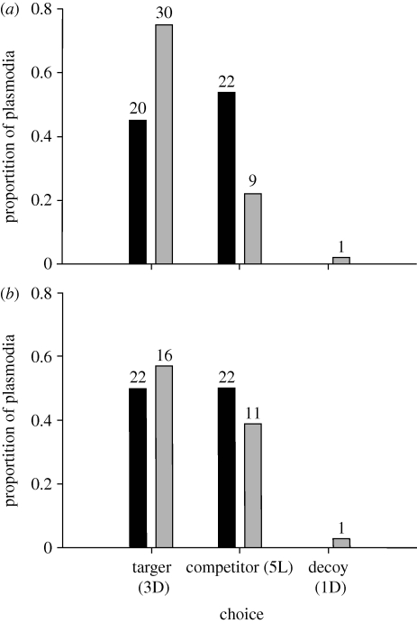

---

## Computational Models

<!-- 
footer: "
    Kobayashi et al. (2006) “Mathematical Model for Rhythmic Protoplasmic Movement in the True Slime Mold,” https://doi.org/10.1007/s00285-006-0007-0

    Jones (2010) “The emergence and dynamical evolution of complex transport networks from simple low-level behaviours,”  https://www.scopus.com/pages/publications/77949441365

"
-->

**Analytically derived**

- the slime mold's thickness is assumed to be/approximated by a mathematical rule
  $$\frac{\partial s}{\partial t} = \nabla\cdot(sM\nabla p)$$
  <!-- - $s(\mathbf x, t)$ is the sol thickness
  - $p(\mathbf x, t)$ is sol pressure -->
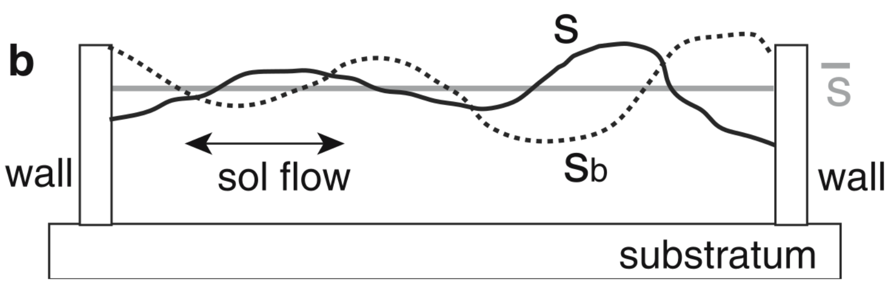

---

## Computational Models

<!-- 
footer: "
    Kobayashi et al. (2006) “Mathematical Model for Rhythmic Protoplasmic Movement in the True Slime Mold,” https://doi.org/10.1007/s00285-006-0007-0

    Jones (2010) “The emergence and dynamical evolution of complex transport networks from simple low-level behaviours,”  https://www.scopus.com/pages/publications/77949441365

"
-->

**Analytically derived**

- the slime mold's thickness is assumed to be/approximated by a mathematical rule
  $$\frac{\partial s}{\partial t} = \nabla\cdot(sM\nabla p)$$
  <!-- - $s(\mathbf x, t)$ is the sol thickness
  - $p(\mathbf x, t)$ is sol pressure -->

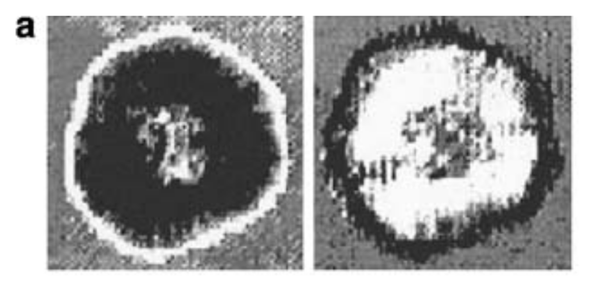
real slime mold patterns

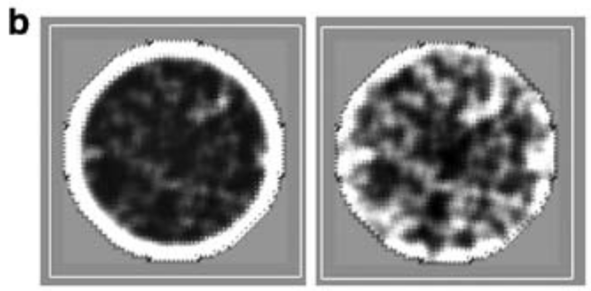
simulation results

---

## Computational Models

<!-- 
footer: "
    Kobayashi et al. (2006) “Mathematical Model for Rhythmic Protoplasmic Movement in the True Slime Mold,” https://doi.org/10.1007/s00285-006-0007-0

    Jones (2010) “The emergence and dynamical evolution of complex transport networks from simple low-level behaviours,”  https://www.scopus.com/pages/publications/77949441365

"
-->

**Analytically derived**

- the slime mold's thickness is assumed to be/approximated by a mathematical rule
  $$\frac{\partial s}{\partial t} = \nabla\cdot(sM\nabla p)$$
  <!-- - $s(\mathbf x, t)$ is the sol thickness
  - $p(\mathbf x, t)$ is sol pressure -->

real slime mold patterns

simulation results

**Monte Carlo-based**

- lots of small particles make small decisions to generate overall behavior

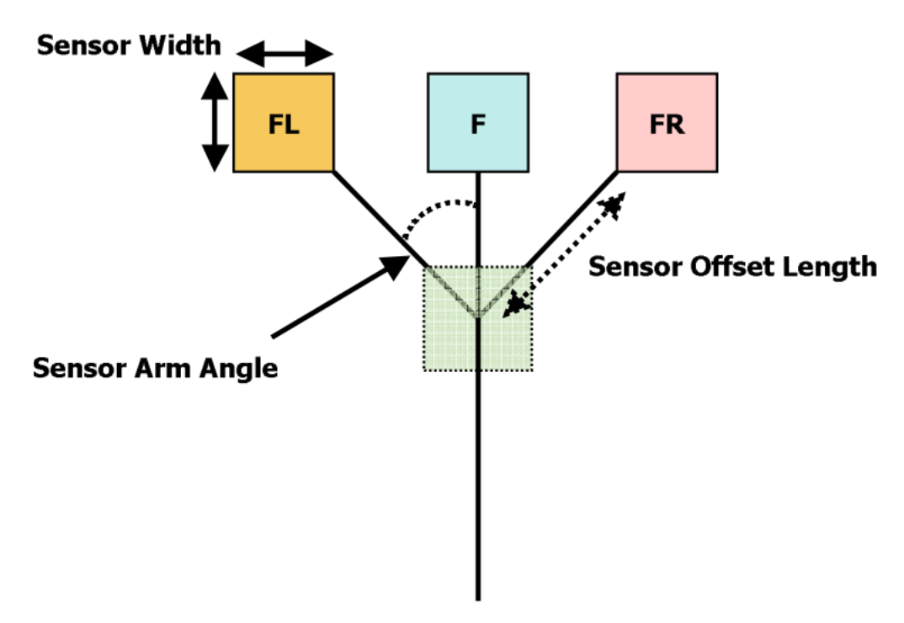

---

## Computational Models

<!-- 
footer: "
    Kobayashi et al. (2006) “Mathematical Model for Rhythmic Protoplasmic Movement in the True Slime Mold,” https://doi.org/10.1007/s00285-006-0007-0

    Jones (2010) “The emergence and dynamical evolution of complex transport networks from simple low-level behaviours,”  https://www.scopus.com/pages/publications/77949441365

"
-->

**Analytically derived**

- the slime mold's thickness is assumed to be/approximated by a mathematical rule
  $$\frac{\partial s}{\partial t} = \nabla\cdot(sM\nabla p)$$
  <!-- - $s(\mathbf x, t)$ is the sol thickness
  - $p(\mathbf x, t)$ is sol pressure -->

real slime mold patterns

simulation results

**Monte Carlo-based**

- lots of small particles make small decisions to generate overall behavior

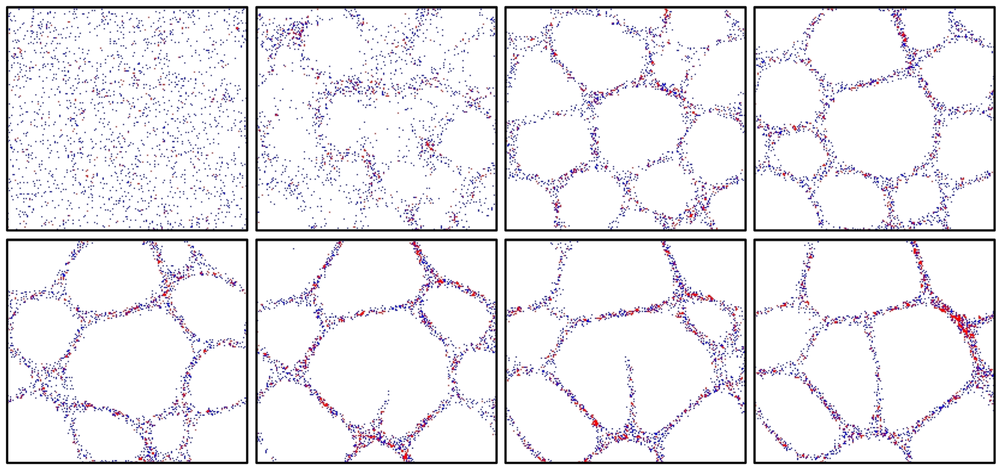

---

### Analyticaly derived models

<!-- 
footer: "
    Tero et al. (2007) “A mathematical model for adaptive transport network in path finding by true slime mold,” https://www.sciencedirect.com/science/article/pii/S002251930600289X
"
-->

Tero et al (2007) adapted Kobayashi et al. (2006)'s model to graphs

- flux $Q_{ij}$ from node $i$ to $j$: 
  $$\qquad Q_{ij} = \dfrac{D_{ij}}{L_{ij}}(p_i - p_j)$$
  where $D_{ij}$ is the conductivity of the edge, $p_i$ are pressures at nodes
- two nodes are special: one is source, one is sink
    

    

    flux _conserved_ at regular node $i$

    $$\sum_j Q_{ij} = 0$$

    

    

    flux _generated_ at source node

    $$\sum_j Q_{\textrm{source},j} = I_0$$

    

    

    flux _consumed_ at sink node

    $$\sum_j Q_{\textrm{sink},j} = -I_0$$

    

    

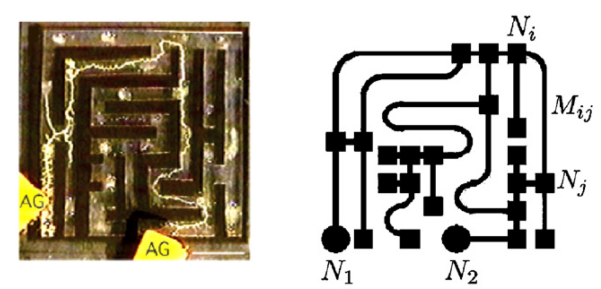

---

### Analyticaly derived models

<!-- 
footer: "
    Tero et al. (2007) “A mathematical model for adaptive transport network in path finding by true slime mold,” https://www.sciencedirect.com/science/article/pii/S002251930600289X
"
-->

Tero et al (2007) adapted Kobayashi et al. (2006)'s model to graphs

- flux $Q_{ij}$ from node $i$ to $j$: 
  $$\qquad Q_{ij} = \dfrac{D_{ij}}{L_{ij}}(p_i - p_j)$$
  where $D_{ij}$ is the conductivity of the edge, $p_i$ are pressures at nodes
- two nodes are special: one is source, one is sink
    

    

    flux _conserved_ at regular node $i$

    $$\sum_j Q_{ij} = 0$$

    

    

    flux _generated_ at source node

    $$\sum_j Q_{\textrm{source},j} = I_0$$

    

    

    flux _consumed_ at sink node

    $$\sum_j Q_{\textrm{sink},j} = -I_0$$

    

    

- adapt the conductivities according to
  $$\dfrac{d}{dt}D_{ij} = f(|Q_{ij}|) - rD_{ij}$$

---

### Analyticaly derived models

<!-- 
footer: "
    Tero et al. (2007) “A mathematical model for adaptive transport network in path finding by true slime mold,” https://www.sciencedirect.com/science/article/pii/S002251930600289X
"
-->

Tero et al (2007) adapted Kobayashi et al. (2006)'s model to graphs

- flux $Q_{ij}$ from node $i$ to $j$: 
  $$\qquad Q_{ij} = \dfrac{D_{ij}}{L_{ij}}(p_i - p_j)$$
  where $D_{ij}$ is the conductivity of the edge, $p_i$ are pressures at nodes
- two nodes are special: one is source, one is sink
    

    

    flux _conserved_ at regular node $i$

    $$\sum_j Q_{ij} = 0$$

    

    

    flux _generated_ at source node

    $$\sum_j Q_{\textrm{source},j} = I_0$$

    

    

    flux _consumed_ at sink node

    $$\sum_j Q_{\textrm{sink},j} = -I_0$$

    

    

- adapt the conductivities according to
  $$\dfrac{d}{dt}D_{ij} = f(|Q_{ij}|) - rD_{ij}$$

- **this is just a lumped circuit model!**
  - $p_i$ is node voltages,
  - $Q_{ij}$ is the current,
  - $G_{ij} = \dfrac{D_{ij}}{L_{ij}}$ is the conductance

<!--  -->

---

### Monte Carlo-based models

<!-- 
footer: "
    Jones (2010) “The emergence and dynamical evolution of complex transport networks from simple low-level behaviours,”  https://www.scopus.com/pages/publications/77949441365
"
-->

simple actions of little particles can give rise to complex behavior at the population level...

Jones (2010)'s model:

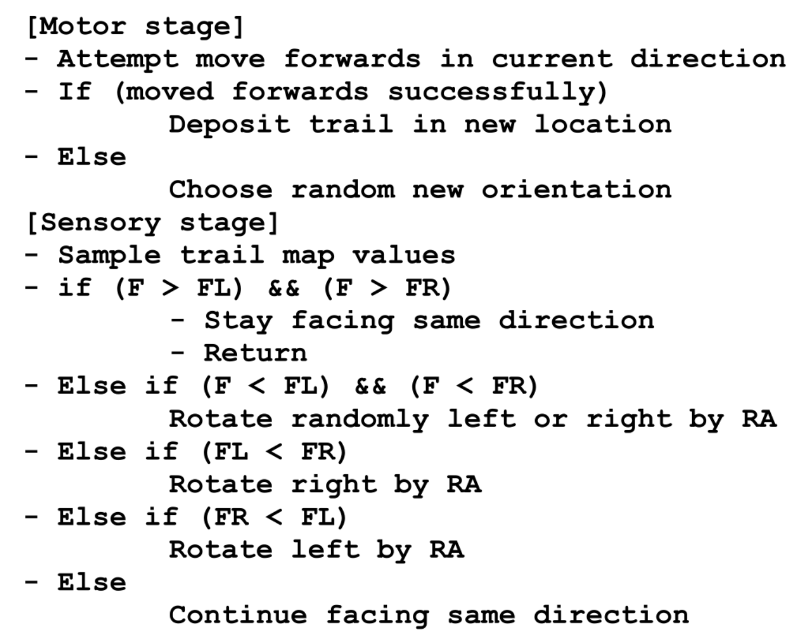

---

### Monte Carlo-based models

<!-- 
footer: "
    Jones (2010) “The emergence and dynamical evolution of complex transport networks from simple low-level behaviours,”  https://www.scopus.com/pages/publications/77949441365
"
-->

simple actions of little particles can give rise to complex behavior at the population level...

Jones (2010)'s model:

**can we build on this?**

- say each particle "looks" at all the nodes it can travel to and assigns a positive "score" to each of them
  - softmax decision:
    - sample the next node proportional to these scores
  - Metropolis-Hastings decision:
    - sample a candidate next node
      - if better, move there
      - if worse, move or stay probabilistically

---

### Shortcomings of the current models

<!-- 
footer: "
    Tero et al. (2007) “A mathematical model for adaptive transport network in path finding by true slime mold,” https://www.sciencedirect.com/science/article/pii/S002251930600289X

    Jones (2010) “The emergence and dynamical evolution of complex transport networks from simple low-level behaviours,”  https://www.scopus.com/pages/publications/77949441365
"
-->

Tero et al. (2007):

- biologically undesirable model
  - the function $f(|Q_{ij}|)$ is not as interpretable
  - food sources are modeled asymmetrically
- no repulsion term: light or slime
- no "exploration"

---

### Shortcomings of the current models

<!-- 
footer: "
    Tero et al. (2007) “A mathematical model for adaptive transport network in path finding by true slime mold,” https://www.sciencedirect.com/science/article/pii/S002251930600289X

    Jones (2010) “The emergence and dynamical evolution of complex transport networks from simple low-level behaviours,”  https://www.scopus.com/pages/publications/77949441365
"
-->

Tero et al. (2007):

- biologically undesirable model
  - the function $f(|Q_{ij}|)$ is not as interpretable
  - food sources are modeled asymmetrically
- no repulsion term: light or slime
- no "exploration"

Jones (2010):

- no accounting of the path-finding effects
- no food, no light, just slime

---

<!-- 
footer: "
    
"
-->

## Results and Outcomes

- a `ratinabox`-style toolbox emerges!
  - `world = slimeWorld(node_locs, C_, light, slime, opts)`
  - `slime = circuitSlime(world, options)`
  - `slime = softmaxSlime(world, options)`
  - `slime = MHslime(world, options)`
- example:

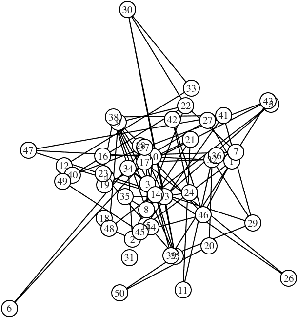 

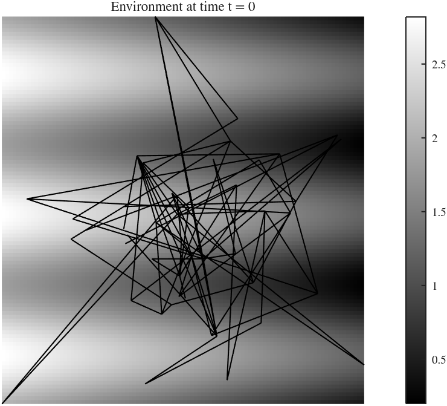

---

<!-- 
footer: "
    
"
-->

## Results and Outcomes

- a `ratinabox`-style toolbox emerges!
  - `world = slimeWorld(node_locs, C_, light, slime, opts)`
  - `slime = circuitSlime(world, options)`
  - `slime = softmaxSlime(world, options)`
  - `slime = MHslime(world, options)`
- example:

 

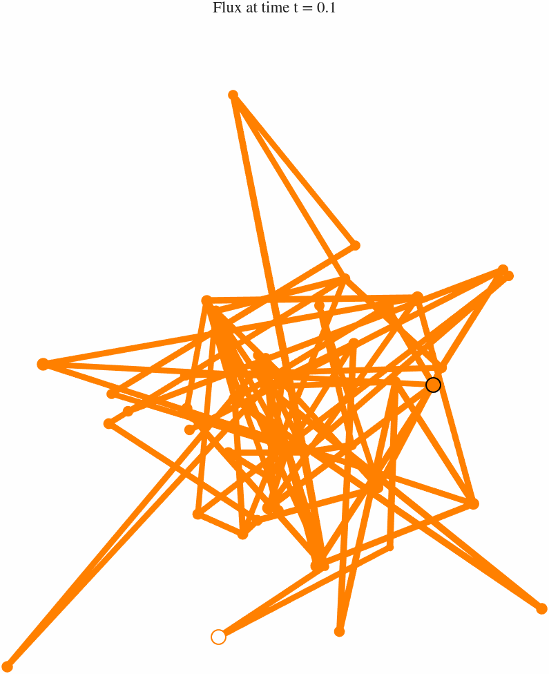

---

## Results and Outcomes

### Path-finding and detours

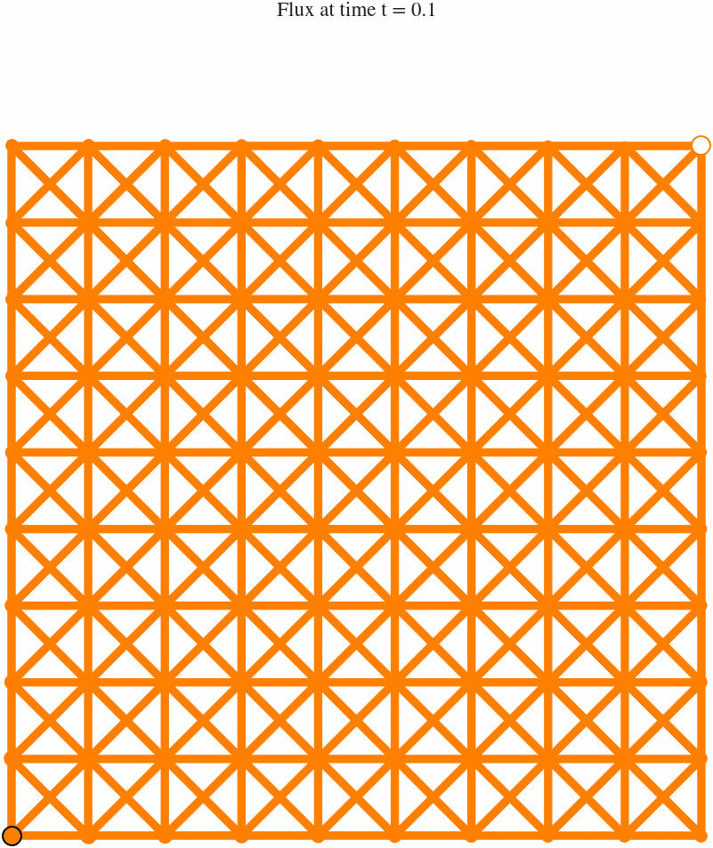

---

## Results and Outcomes

### Path-finding and detours

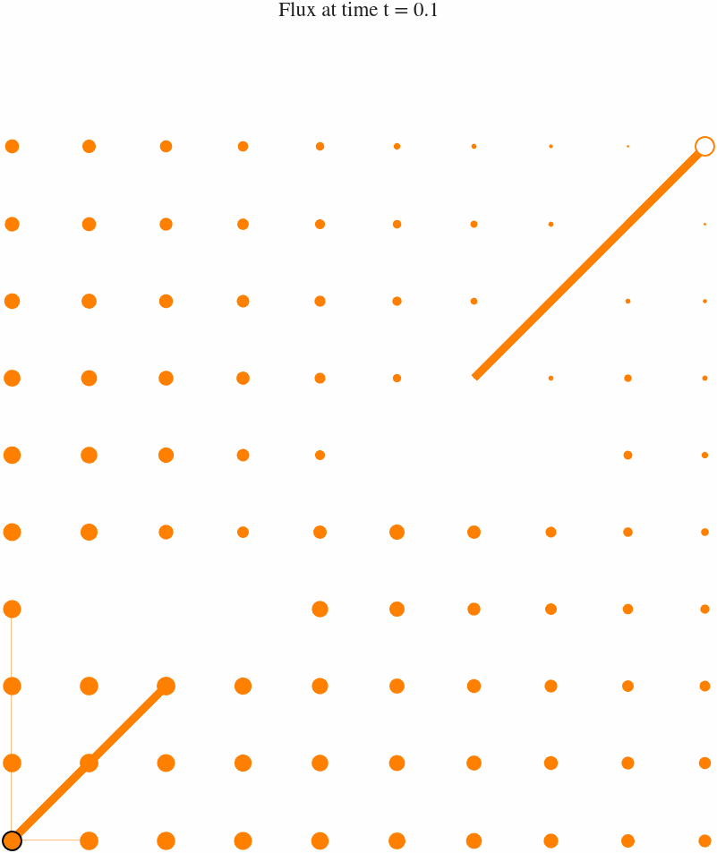

---

## Results and Outcomes

### Path memory

---

## Results and Outcomes

### Path memory

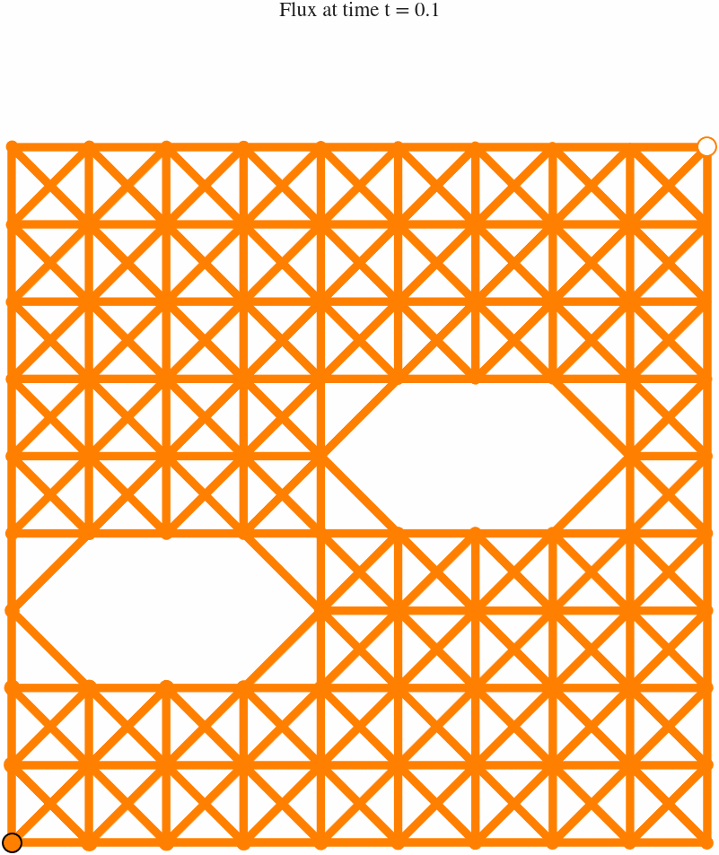

---

## Results and Outcomes

### Undesirable paths

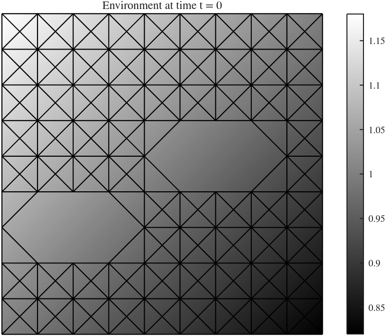

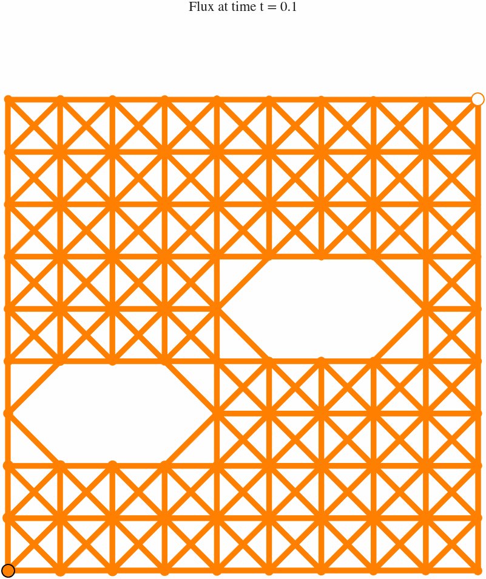

---

<!-- 
footer: "
    
"
-->

## Future directions

- Tolman's sun maze: Latent learning in slime molds?

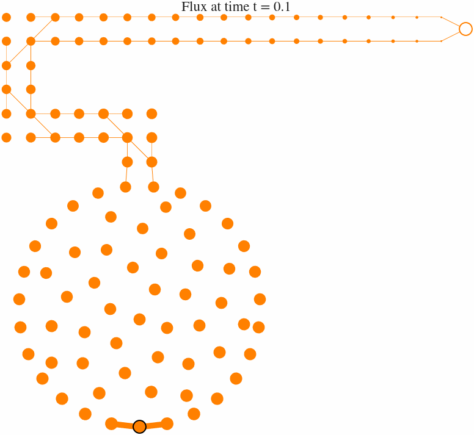

---

<!-- 
footer: "
    
"
-->

## Future directions

- Tolman's sun maze: Latent learning in slime molds?

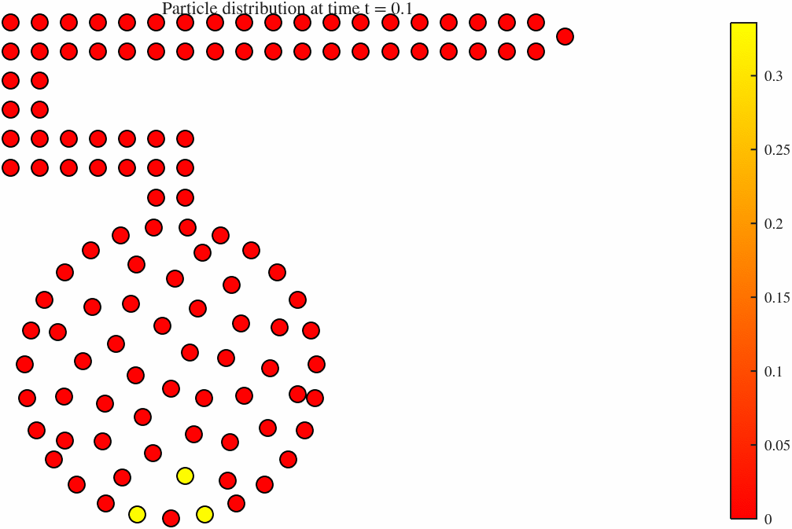

---

<!-- 
footer: "
    
"
-->

## Future directions

- Tolman's sun maze: Latent learning in slime molds?

- Spatial memory
- Temporal memory: accommodation to repeated stimuli
- Foraging experiments
- Memory sharing in slime molds in contact
- ...

---

## Thank you!